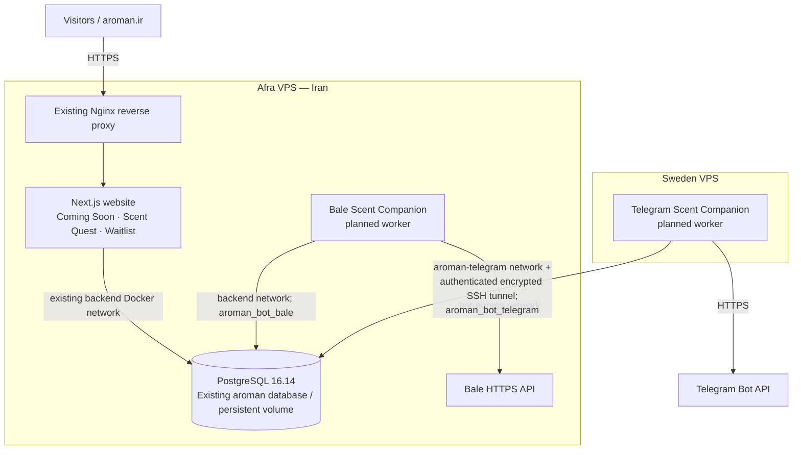

# AROMAN coming-soon website

A mobile-first Persian landing page for AROMAN, built with Next.js, React, Tailwind CSS, TypeScript, and PostgreSQL.

## Deployment architecture and launch roadmap

> **Status snapshot — 2026-11-09:** The existing website and PostgreSQL are running on Afra. Telegram and Bale workers are implemented and locally tested but **not deployed**. PRs [#26](https://github.com/AromanCo/coming-soon-page/pull/26) and [#27](https://github.com/AromanCo/coming-soon-page/pull/27) are merged. **Production database changes and bot activation remain NO-GO** until the gates below pass. This roadmap describes the *target*, not a claim that every component is live.

### Final architecture (two existing VPS servers)

- **Afra (Iran):** Existing Nginx/Next.js website and PostgreSQL remain in the current Compose project `aroman-coming-soon`. Bale is an **opt-in** worker on the existing `backend` network plus a separate `bot-egress` network. Sharing `backend` is a temporary architectural tradeoff, **not** network-level isolation.
- **Sweden:** Runs **only** the Telegram worker (no separate website, PostgreSQL, Bale service, or migrations). The worker joins the pre-existing external `aroman-telegram` network; it uses the existing authenticated, encrypted SSH tunnel to reach Afra's PostgreSQL. Do not expose PostgreSQL publicly.
- **Shared database with separate identities:** Website runtime `aroman_app`, schema owner/migrator `aroman_migrate`, Telegram `aroman_bot_telegram`, and Bale `aroman_bot_bale`. Provider-specific grants and `session_user`-based row-level security (RLS) must be verified **before** bots run. The existing database bootstrap owner is currently `aroman`; do not assume `aroman_admin` exists on Afra.
- **Current production-specific Compose:** `compose.yaml`, then Afra's host-managed `compose.ecr.yaml`, `compose.nginx.yaml`, and `aroman-db-compat.override.yaml`, in exactly that order. Those host-managed files are **not** in this repository. The compatibility override retains `postgres:16-alpine` with `pull_policy: never`; do not replace it with the repository's separate `compose.prod.yaml` stack.
- **Database transport:** PostgreSQL SSL is currently **off**. The Sweden database connection must use the authenticated encrypted SSH tunnel, never an unencrypted public route. Docker bridge membership alone does not enforce egress restrictions.
- **Duration:** Temporary coming-soon rollout (roughly 2–3 months); reuse existing infrastructure instead of creating a third VPS, second database, or unapproved backup system.

### Current implementation vs. production

| Component | Current status | Required before launch |
| --- | --- | --- |
| Coming Soon / Scent Quest / Waitlist website | Running on Afra; final QA outstanding | Verify public flows, privacy/content, and production configuration |
| PostgreSQL / existing Waitlist schema | PostgreSQL 16.14 running; migrations 001–002 present | Preserve data and validate existing backup/restore |
| Bot schema (003–008, including retention audit 005) | Passed isolated PostgreSQL 16.14 rehearsal; **not applied on Afra** | Apply under explicit database-change approval; verify schema and RLS |
| Restricted runtime and provider database roles | Passed isolated rehearsal; **not provisioned on Afra** | Provision securely and prove grants, RLS, and website compatibility |
| Sweden tunnel / Docker network | Previously tested; network and route established | Recheck service persistence, authenticated route, egress rules and access during deployment |
| Telegram worker | Source, tests and Compose ready; **not running** | Approved image, secrets, provider login and end-to-end testing |
| Bale worker | Network correction merged in PR #27; **not running** | Approved image, secrets, provider login and end-to-end testing |
| Release security/operations | CI and local tests pass; runtime readiness not complete | Assess dependency alerts, backup/recovery, monitoring, rollback and final acceptance |

### Critical-path roadmap (complete in order; parallelize only independent checks)

**M0 — Repository and code integration: DONE**

- [x] Merge Telegram tunnel/network configuration (PR #26).
- [x] Merge Bale network correction that leaves `db`, `web` and `migrate` unchanged (PR #27).
- [x] Rehearse migration ordering, role transition, least-privilege Website functions and provider RLS against a **synthetic disposable PostgreSQL 16.14 database**.
- [ ] Sync the approved merged `main` revision into local release preparation; preserve untracked image/screenshot directories.

**M1 — Afra/Sweden production preflight: NEXT; READ-ONLY**

- [ ] Confirm the exact effective **four-file** Afra Compose configuration, source revision, live container and persistent database volume identity. Confirm PostgreSQL 16.14 remains unchanged and has no published host port.
- [ ] Verify a usable, current backup and independently tested restore **for this actual database** using the existing process. No new backup infrastructure is required, but an unverified restore is a **stop condition**.
- [ ] Verify Secret-file paths, ownership, permissions and approved delivery to a **disposable PostgreSQL client** (not by modifying mounts in the running database container). Do not print secret values.
- [ ] Confirm how the existing Website will receive `DATABASE_USE_LEAST_PRIVILEGE_FUNCTIONS=true` and `aroman_app` credentials in the effective Afra override; check the environment-file permissions before use.
- [ ] Recheck Sweden's `aroman-telegram` network, SSH tunnel health/boot persistence, SCRAM authentication path and host/provider firewall policy. Check Afra Bale egress controls too.
- [ ] Record a bounded change/rollback procedure, minimal approved service interruption for Website cutover, and explicit authorization for database changes.
- **Gate:** All facts verified, recovery ready and change approved; otherwise **NO-GO**.

**M2 — Additive Afra database schema: REQUIRES APPROVAL**

- [ ] Apply only migrations `003`, `004`, `005`, `006`, `007` and `008` in filename order against the **existing** Afra database using an approved SQL client/process. Review lock contention first; do **not** start the repository's generic `migrate` service.
- [ ] Verify four bot tables, indexes, constraints, retention audit table, RLS policies and preservation of existing Waitlist records.
- [ ] If a migration fails, stop and inspect partial committed state. Do not assume `IF NOT EXISTS` repairs mismatched objects; never drop the existing volume.
- **Gate:** Schema verified, Website remains healthy, no unintended DB restart.

**M3 — Restricted Website roles and cutover: REQUIRES APPROVAL**

- [ ] Prepare role secrets without exposing passwords. The current `create-roles.sql` can **rotate the existing `aroman` password**, change grants and transfer object ownership; do **not** run it unreviewed against production.
- [ ] Stage `aroman_migrate` and `aroman_app`, ownership and `SECURITY DEFINER` registration/rate-limit functions. Confirm old Website credentials remain valid until cutover.
- [ ] Prove `aroman_app` can register and rate-limit an approved synthetic submission but cannot directly read/delete Waitlist data or modify schema.
- [ ] Change the Website's database identity and enable the least-privilege-function mode through the approved effective Afra config. Recreate **only** the web container if authorized, without dependencies; verify its health and a synthetic signup. A brief Website interruption is possible with the current single-container design.
- [ ] Document and test reverting **only the Website configuration** to the previous known-good connection if cutover fails; leave additive schema in place.
- **Gate:** Website works under `aroman_app` and database-container identity/volume/image are preserved.

**M4 — Bot roles and provider isolation: REQUIRES APPROVAL**

- [ ] Execute reviewed provider-role reconciliation and grants only after schema/RLS is verified; keep logins disabled until individual grants are complete.
- [ ] Verify distinct SCRAM credentials, `NOINHERIT`, no elevated privileges, no memberships, and no database-object ownership for provider roles.
- [ ] Verify each provider can access only its own rows in sessions, poll offsets, outbox and delivery metrics; deny cross-provider writes and Waitlist reads.
- **Gate:** Both provider identities and RLS pass before either bot starts.

**M5 — Sweden Telegram activation: REQUIRES SEPARATE DEPLOYMENT APPROVAL**

- [ ] Prepare/verify the approved immutable bot image and isolated Telegram-only Secret files; verify the existing tunnel and network from the actual worker path.
- [ ] Render `compose.sweden.telegram.yaml`; confirm there is **only** `telegram-bot`, no published ports, and no competing Telegram polling worker or webhook.
- [ ] Start **only** Telegram with an approved worker-only command; verify advisory lock, polling, Scent Companion conversation, state persistence, `/forget` and reconnect behavior without logging personal data.
- **Gate:** Telegram is operational on Sweden against the shared Afra database.

**M6 — Afra Bale activation: REQUIRES SEPARATE DEPLOYMENT APPROVAL**

- [ ] Verify the approved Bale image/Secret files, effective five-file Compose render (four original files **plus** `compose.afra.bale.yaml`), and unchanged `db`/`web`/`migrate` service definitions.
- [ ] Confirm existing `backend` connectivity, independent `bot-egress` and egress firewall policy. Check for existing Bale polling workers/webhooks.
- [ ] Start **only** `bale-bot` with `--no-deps --no-build --pull never`; do not run `up` for the full project. Verify advisory lock, conversations, state, `/forget` and Website health.
- **Gate:** Bale is operational without recreating PostgreSQL or the Website.

**M7 — Release acceptance and temporary operations: FINAL GO/NO-GO**

- [ ] Public Website, Scent Quest imagery, waitlist acceptance/error/rate-limit cases and mobile/RTL accessibility pass.
- [ ] Telegram and Bale provider journeys, privacy/consent disclosures, session expiry, provider isolation and failure/recovery scenarios pass.
- [ ] Triage GitHub's reported **16 dependency alerts** (2 critical, 6 high, 5 moderate, 3 low as of the prior push); assess actual production exposure and remediate or formally document release-blocking issues.
- [ ] Confirm privacy/content approvals, secret hygiene, least privilege, health/log alerts and tested service-specific stop/rollback steps.
- [ ] Record operator ownership, minimal monitoring for the temporary 2–3 month operation and an explicit end-of-campaign retirement/data-handling decision.
- **Gate:** Product and technical owners approve a **GO** only after the evidence is recorded.

### Operational boundaries and next action

**Immediate next step: M1 production preflight (read-only).** Do not conflate merged PRs or green CI with permission to migrate, provision roles, recreate containers or activate bots. Obtain separate approval for each production-changing stage.

**Never on Afra without an explicit, reviewed change:** `docker compose up` for the full project, an unscoped `migrate` service, `compose.prod.yaml` replacing host overrides, PostgreSQL image pulls/upgrades, `down -v`, database volume deletion, unreviewed role reconciliation, or app/bot restarts.

For detailed runbooks and security controls see [Afra PostgreSQL image safety](docs/afra-postgres-image-safety.md), [Sweden/Afra bot deployment](docs/sweden-afra-bot-deployment.md), [Scent Companion bots](docs/scent-companion-bots.md), and [production deployment](docs/production-deployment.md). The local-development commands below are **not** the deployment procedure for Afra's existing four-file production stack.

---

## Requirements

- Node.js 24 LTS (24.21.0 is pinned by this repository)
- npm 11+
- PostgreSQL 14+

Docker users only need Docker Engine with the Compose plugin; the Compose stack
provides Node.js 24.21.0 and PostgreSQL 16.

## Local development

1. Select the repository's Node version:

   ~~~sh
   nvm use
   ~~~

2. Install the exact dependency graph:

   ~~~sh
   npm ci
   ~~~

3. Copy .env.example to .env.local and fill in the required values.

4. Apply the database migrations in filename order:

   ~~~sh
   for migration in db/migrations/*.sql; do
     psql "$DATABASE_URL" -v ON_ERROR_STOP=1 -f "$migration"
   done
   ~~~

5. Start the app:

   ~~~sh
   npm run dev
   ~~~

Without both DATABASE_URL and WAITLIST_HASH_SECRET, the UI deliberately shows that signup is unavailable and disables submission. It never displays a fabricated success.

## Docker Compose

Copy the example environment and replace every placeholder secret:

~~~sh
cp .env.example .env
~~~

Keep POSTGRES_PASSWORD synchronized with the password in DATABASE_URL. Within
Compose, DATABASE_URL must use db as its hostname, not localhost. If the
password contains URL-reserved characters, percent-encode it in DATABASE_URL.

Build and start the complete production-like stack:

~~~sh
docker compose config
docker compose build
docker compose up -d
docker compose ps
~~~

The stack starts PostgreSQL, waits for it to become healthy, applies every SQL
file in db/migrations in filename order, and only then starts the standalone
Next.js server. PostgreSQL is not published to the host. WEB_PORT controls the
host port used by the web service.

Useful lifecycle commands:

~~~sh
# Follow application and database logs
docker compose logs -f web db migrate

# Re-run all idempotent migrations
docker compose run --rm migrate

# Restart the application without touching PostgreSQL data
docker compose restart web

# Rebuild and recreate the web container after source changes
./scripts/rebuild-development-stack.sh

# Stop containers while preserving the named database volume
docker compose down
~~~

Do not use docker compose down -v unless permanent database deletion is
explicitly intended. The postgres_data named volume persists subscriptions and
rate-limit state across ordinary stops, starts, and container recreation.

`docker compose up -d` and `docker compose restart web` do not rebuild the
Next.js application. After pulling frontend changes, use the rebuild helper:

~~~sh
git switch main
git pull --ff-only origin main
./scripts/rebuild-development-stack.sh
~~~

The helper always selects `compose.yaml`, rebuilds `web` from the current
checkout, starts the existing PostgreSQL volume, applies the idempotent
migrations, and force-recreates only the web container. It labels the image
with the Git revision and verifies that the running container uses that label.
It never runs `down` or removes a volume.

To inspect the revision later without printing environment values:

~~~sh
container_id=$(docker compose -f compose.yaml ps -q web)
docker inspect --format '{{index .Config.Labels "org.opencontainers.image.revision"}}' "$container_id"
~~~

If a different Compose file or `COMPOSE_PROJECT_NAME` is used, it is a separate
stack with separate image/container selection. Check `docker compose ls` and
`docker compose -f compose.yaml ps` before diagnosing browser caching.

## Environment variables

| Variable | Required | Purpose |
| --- | --- | --- |
| NEXT_PUBLIC_SITE_URL | Production | Canonical site URL used by SEO metadata and sitemap |
| DATABASE_URL | Waitlist | Server-only PostgreSQL connection string |
| DATABASE_SSL | Provider-dependent | Set to true when PostgreSQL requires TLS |
| DATABASE_SSL_REJECT_UNAUTHORIZED | Provider-dependent | Keep true; set false only when the provider explicitly requires it |
| WAITLIST_HASH_SECRET | Waitlist | Long random secret used to HMAC network identifiers for abuse prevention |
| NEXT_PUBLIC_INSTAGRAM_URL | Optional | Official HTTPS Instagram profile URL; hidden when empty or invalid |
| NEXT_PUBLIC_TELEGRAM_URL | Optional | Official HTTPS Telegram channel URL; hidden when empty or invalid |
| NEXT_PUBLIC_LINKEDIN_URL | Optional | Official HTTPS LinkedIn URL; hidden when empty or invalid |
| NEXT_PUBLIC_PRIVACY_EMAIL | Production | Public address for data access/deletion requests |
| WEB_PORT | Docker | Configurable host port mapped to container port 3000 |
| POSTGRES_USER | Docker | PostgreSQL role initialized by the database container |
| POSTGRES_PASSWORD | Docker | PostgreSQL role password; must match DATABASE_URL |
| POSTGRES_DB | Docker | PostgreSQL database initialized by the database container |

Generate the hash secret with openssl rand -hex 32. Never expose DATABASE_URL or WAITLIST_HASH_SECRET as NEXT_PUBLIC variables.

## Waitlist behavior

- Server-side Iranian mobile validation for local, `+98`, and `0098` formats
- Persian, Arabic, and English digit normalization to canonical E.164 storage
- Explicit required marketing consent
- Persistent PostgreSQL storage
- Duplicate detection with a partial unique index on canonical phone numbers
- Preservation of legacy email-only registrations
- Five attempts per hashed network identifier per ten-minute window
- Honeypot field for simple bot filtering
- A 4 KiB request-body limit and required JSON media type on the public endpoint
- `Cache-Control: no-store` on every waitlist response
- Loading, accepted, rate-limit, unavailable, and network-error states

New phone registrations are stored without an email address. Phone ownership
is not verified in this release because no OTP flow or SMS provider is active.
The schema preserves `created_at`, `consented_at`, `source`, security metadata,
and the monotonic identity `id`; existing email rows remain valid.

The public endpoint returns the same `202 Accepted` status and response body for
new and duplicate valid numbers. PostgreSQL still prevents duplicate rows, and
a repeated submission does not update the original consent or registration
timestamps. This removes the direct duplicate-status signal. Small timing
differences at the database and network layers may still be observable, so the
persistent IP rate limit remains necessary and the endpoint never echoes the
submitted number.

### Trusted proxy requirement

Production uses `CLIENT_IP_MODE=caddy` and accepts only a single valid
`X-Aroman-Client-IP` value. The production Caddy proxy overwrites that header
from its direct peer address and sanitizes `X-Forwarded-For`, `X-Real-IP`, and
`Forwarded`; neither the Next.js nor PostgreSQL container has a published host
port. Missing or malformed canonical identities fail closed.

The development Compose file explicitly enables a spoofable forwarded-header
compatibility mode for local integration tests. Never enable
`ALLOW_INSECURE_CLIENT_IP_HEADERS` in production. If a CDN or load balancer is
introduced, re-design and re-test the trusted-hop configuration before release.

The reverse proxy or hosting edge should also enforce coarse request-rate,
connection, header-size, body-size, and timeout limits before traffic reaches
Next.js. Terminate TLS there and set HSTS only on the HTTPS production host.

### Future OTP, SMS, and invitation operations

No SMS is sent by the current application. A later implementation should:

1. Integrate an approved Iranian SMS provider through a server-only adapter,
   with credentials held in a secret manager and delivery logs free of full
   phone numbers.
2. Generate cryptographically random, single-purpose OTPs; store only hashes;
   and expire them after a short configured window.
3. Add per-number and per-network verification-attempt and resend limits on top
   of the existing signup rate limit.
4. Add explicit verification state and timestamps through a new migration.
   Never infer ownership from successful storage or SMS delivery alone.
5. Make resend and provider retry operations idempotent, with bounded retries
   and auditable provider message identifiers.
6. Build SMS invitation cohorts as a separate authenticated administrative
   workflow. Select cohorts deterministically using `created_at` and `id`,
   record the operator and batch, and do not expose cohort operations publicly.
7. Add durable opt-out and unsubscribe handling before promotional SMS is sent,
   and ensure deletion requests are honored across provider and application
   records.

The rate-limit table is intentionally persistent across server instances. Periodically remove old buckets:

~~~sql
DELETE FROM waitlist_rate_limits
WHERE window_start < NOW() - INTERVAL '7 days';
~~~

## Project structure

~~~text
src/app/
  api/health/route.ts    Database-aware container health endpoint
  api/waitlist/route.ts  Server-side signup endpoint
  privacy/page.tsx       Persian privacy information
  layout.tsx             RTL document shell and SEO metadata
  page.tsx               Landing page
src/components/
  brand-mark.tsx         Temporary brand asset presentation
  social-links.tsx       Validated official social-link components
  site-footer.tsx        Configured social/privacy links
  waitlist-form.tsx      Accessible client form
src/lib/waitlist.ts      PostgreSQL and anti-abuse logic
src/lib/iranian-mobile.ts Iranian mobile normalization and validation
db/migrations/           Idempotent database schema
tests/                   Unit and Docker-backed integration tests
public/images/           Replaceable campaign artwork
Dockerfile               Multi-stage standalone production image
compose.yaml             Web, database, and one-shot migration services
compose.prod.yaml        Caddy and isolated production service topology
docs/production-deployment.md  VPS, backup, recovery, and release runbook
~~~

## Validation

~~~sh
npm run typecheck
npm run lint
npm test
npm run build
npm audit
~~~

## Deployment prerequisites

- A Node.js 24 runtime capable of running a Next.js server; this project is not a static export because the waitlist API is server-side.
- A reachable PostgreSQL database with the migration applied.
- All required environment variables set in the deployment platform.
- The production Caddy trust boundary (or an equivalently reviewed canonical client-IP contract) for per-client abuse limiting.
- The official AROMAN logo, favicon, social URLs, privacy contact, canonical URL, and final approved campaign image.
- A review of the current Next.js security release immediately before deployment. The repository currently pins the patched stable release 16.4.1.

The VPS production architecture and commands are documented in
`docs/production-deployment.md`. They are not an instruction to deploy without
explicit approval.

## Asset replacement

public/images/aroman-hero.png is original generated campaign artwork and contains no logo or text. Replace it with approved brand photography when available while keeping a portrait crop.

The hexagonal emblem and AROMAN text in brand-mark.tsx and icon.svg are clearly temporary code-based presentations based only on the supplied hexagonal reference direction. They are not a replacement for the official brand master. Swap them for official clean SVG/PNG variants without changing their proportions.

## License and template provenance

The original repository was distributed under GPL-3.0 and included a generic coming-soon template. The implementation has been substantially rewritten, but the existing LICENSE is intentionally preserved.

For distributed copies of this covered work, GPL-3.0 generally requires preserving copyright and license notices, providing the corresponding source under GPL-3.0, marking modifications, and not adding restrictions that conflict with the license. Running the software only as a hosted service does not by itself trigger source distribution under GPL-3.0 (unlike AGPL), though distributing builds or copies can. This summary is operational guidance, not legal advice; obtain counsel before relicensing or combining this code with incompatible proprietary code.
